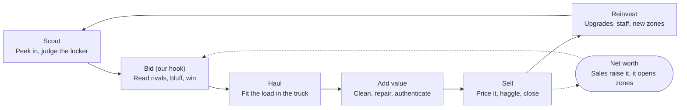
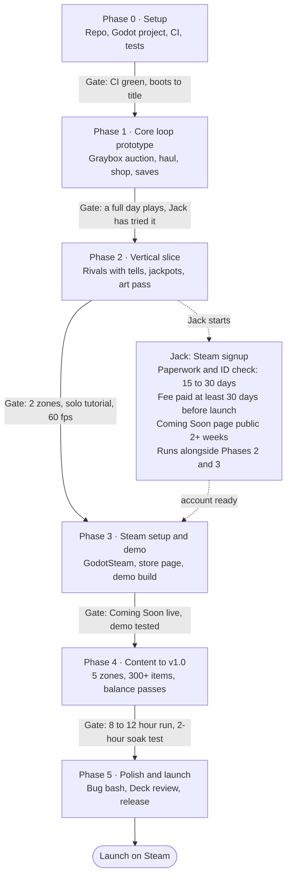

# Storage Auction Game — Build Plan for Claude Code

Oct 27, 2026 · @Jack

> This is Jack's build plan, copied word for word from
> [`original/build_plan_2026-10-27.pdf`](original/build_plan_2026-10-27.pdf).
> It is the source of truth for scope and rules. Decisions taken while
> building are logged in [`DECISIONS.md`](DECISIONS.md), not edited in here.
>
> **Changed by Jack on 2026-10-27: the game is now co-op for 1 to 4 players,
> online.** Where this plan says single-player, no multiplayer or no walking
> character, [`MULTIPLAYER.md`](MULTIPLAYER.md) wins, and its revised roadmap
> replaces the phase numbers below (a new Phase 2, "Co-op foundation", shifts
> the later phases up by one).

## How to use this doc

Claude Code: this is your brief. Read it end to end, then build the game phase by phase, starting at Phase 0. Jack wants to be asked as little as possible, so decide what you can and keep moving.

**Working rules**

- **Decide reversible things yourself.** Code structure, internal names, tuning numbers and tool choices within this plan are yours. Log each real decision in `docs/DECISIONS.md` with one line of why.
- **Ask Jack only about the items in "Decisions reserved for Jack"** at the end of this doc: spending money, the public name, anything published, anything hard to undo.
- **Finish each phase cleanly.** The game runs, tests pass, work is committed and pushed. Then post a short status: what works, what's next, any blocker.
- **Commit small and often.** One feature per branch, merge to `main` once CI is green.
- **Copy nothing from the Roblox game.** No code, art, sounds, UI, item names or text. Mechanics only (see the guardrails section).
- **Keep `CLAUDE.md` at the repo root** with a summary of this plan, conventions, and how to run and test, so every new session starts with context.
- **Put content in data files, not code.** Items, lockers, prices and bidder personalities live in data so balancing never needs a code change.
- **If a step here proves wrong or impossible,** take the closest alternative, log it in `DECISIONS.md`, and keep going.

## Project summary and goals

We are building an original single-player storage-auction tycoon for PC, sold on Steam. The player wins storage lockers at auction, hauls and appraises what's inside, sells it from their own shop, and grows from a junkyard hustler into a top dealer.

- **Platform:** Windows on Steam first. Steam Deck Verified is a goal. macOS and Linux only if the engine export is cheap.
- **Mode:** single-player and offline. Online multiplayer is out of scope for v1.0.
- **Business model:** one-time purchase, no microtransactions. Jack sets the price.
- **Working title:** placeholder until Jack picks a name (see the last section). Use `storage-auction-game` for the repo and code.

| Milestone | Zones | Items | What's in it |
|---|---|---|---|
| First playable | 1 | ~30 | Auction vs. 3 AI bidders, haul, shop with 4 shelves, one customer type, save/load |
| Steam demo | 2 | ~100 | Appraisal, cleaning, repair, haggling, upgrades, tutorial, final UI and audio |
| v1.0 | 5 | 300+ | Events, collections, achievements, endless play after the main progression |

**Success test:** a new player understands the loop within 10 minutes without help, wants "one more locker," and the game holds 60 fps on Steam Deck.

## Reference research

The Roblox game proves the loop is sticky: Storage Hunters: Open World by Absolute Zero! launched June 2, 2026 ([Rotrends](https://rotrends.com/game/10261267004/UPD-Storage-Hunters-Open-World)), peaked at 55K concurrent players in August ([RoWatcher](https://rowatcher.com/games/10261267004/storage-hunters-open-world)), and passed 105.8M visits by mid-September ([All Things How](https://allthings.how/roblox-storage-hunters-update-release-time-and-teased-new-areas/)). Retention is steep, though: 14.6% of players reach 10 auctions won and 3.9% reach 100 (same source).

**How it plays** ([auction guide](https://allthings.how/storage-hunters-open-world-auctions-how-bidding-and-zones-work/), [tips guide](https://allthings.how/storage-hunters-open-world-tips-to-grow-your-net-worth-fast-roblox/))

- **Auction:** you pay an entry fee, peek at part of the locker, then bid against NPCs and other players. Every raise resets the countdown. Bids register through a timing bar, so a mistimed press fails.
- **Haul:** the win loads into your vehicle, which has a weight limit. You drive it back to your shop.
- **Add value:** services grade items, clean dirt, open safes, repair broken goods, or quick-sell junk. Grading and cleaning take time unless you pay premium currency.
- **Sell:** customers make offers you accept or refuse. Upgrades raise opening offers, add tips, and unlock an assistant that sells at a margin you set.
- **Jackpots:** any item can roll one or more of 20+ value modifiers, from 0.8x up to 100x. Stacks add rather than multiply. Weather events and placed trophies raise the odds ([mutations guide](https://progameguides.com/roblox/storage-hunters-open-world-mutations-guide/)).
- **Luck and side goals:** hidden collectibles grant permanent luck, NPC quests and achievements pay premium currency.

| Zone | Net worth to unlock |
|---|---|
| Junkyard | Free |
| Back Alley | $750 |
| Cargo Ship | $7,000 |
| Farm area | $10,000 |
| Shipyard | $125,000 |

Those gates pace the whole game: each zone costs more per auction and holds better loot. Monetization is Robux passes such as +50% vehicle weight and +50% selling space (tips guide above).

**Steam competition**

| Game | Status | Price | Style |
|---|---|---|---|
| [Storage Hunter Simulator](https://www.astragon.com/news/detail/storage-hunter-simulator-cult-early-access-hit-hits-10-on-november-27) | 1.0 since Nov 27, 2025; consoles in 2026 | $24.99 | Realistic 3D sim, 5-district open world, co-op ([Fanatical](https://www.fanatical.com/en/game/storage-hunter-simulator)); item checks and locksmith jobs take in-game hours ([preview](https://www.thumbculture.co.uk/?p=72197)) |
| [Storage Hunter Bid War Simulator](https://www.nintendo.com/en-gb/Games/Nintendo-Switch-download-software/Storage-Hunter-Bid-War-Simulator-3061760.html) | Switch, Mar 28, 2026 | — | Small-scale bid-and-flip |

**Takeaway:** the realistic, slow sim is already taken at $24.99. The open lane is what made the Roblox game spread: a fast, readable, jackpot-driven loop, at a lower price and built for short sessions.

## Originality and legal guardrails

Borrow mechanics, never expression. A genre loop like bid, haul and sell is free to use; the Roblox game's code, art, sounds, text and names are not. This is a practical rule set, not legal advice.

**Fine to use**

- The core loop: bid on lockers, haul the contents, sell them in your own shop.
- General system ideas: rare value modifiers, zones unlocked by net worth, customers who make offers, a luck stat, collectibles. Build them with our own names, numbers and tuning.

**Off limits**

- Any file from the Roblox game or the Roblox client cache: models, textures, sounds, UI, scripts.
- Its title, logo, zone names, modifier names and multiplier table, item names, NPC names, quest text, and screenshots or footage in our marketing.
- "Storage Hunter(s)" or "Storage Wars" anywhere in our title. Those names belong to TV shows, the Roblox game and the Steam competitor.
- Real brands, logos and celebrity names on items. Use invented or parody brands.
- Assets licensed "personal use only" or with unclear terms.

**Checks Claude Code runs**

- [ ] Every third-party asset gets a line in `CREDITS.md`: name, source URL, license.
- [ ] Only licenses that allow commercial use: CC0, CC-BY (with credit), or paid licenses that say so.
- [ ] Any AI-generated content that ships is listed in `docs/AI_CONTENT.md`, so Jack can disclose it in Steam's content survey.
- [ ] Before the name is final: search Steam, the web, and the USPTO trademark database for conflicts.

## Design pillars and our hook

Our hook: every auction is a poker hand. Rival bidders have personalities, budgets and visible tells, so winning a locker is a read, not a timing bar or a coin flip. Wrap that in a fast, stylized, jackpot-driven tycoon loop that fits a 5-minute session.

**Pillars** (every feature must serve at least one)

1. **Every bid is a read.** Rivals bluff, hesitate, overpay for their favorite category and remember how you treated them. Skill beats luck over time.
2. **Jackpot moments.** Rare finds and value modifiers get a loud reveal: slow-motion unboxing, sound sting, a price counter spinning up. These are the moments people clip and share.
3. **One more locker.** A full bid, haul and sell cycle takes 3 to 5 minutes. Travel and menus never eat more than about 30 seconds of it.
4. **Watch the empire grow.** The shop visibly fills with shelves, decor and staff, and net worth is the score that unlocks everything.

**How we differ**

| | Roblox reference | Storage Hunter Simulator | Ours |
|---|---|---|---|
| Bidding | Timing bar vs. NPCs and players | Realistic auction | Readable AI rivals with tells and memory |
| Pace | Fast, drive around an open world | Slow, in-game hours for appraisal | Fast, map travel, timers measured in seconds |
| Money model | Free, Robux passes | $24.99 | One price, no microtransactions |
| Look | Roblox blocks | Realistic 3D | Stylized low-poly dioramas |

**Scope cuts (on purpose)**

- No free-roam driving. Travel is a map screen with a short animated drive.
- No multiplayer and no premium currency in v1.0.
- Fixed-angle 3D scenes driven by mouse or controller, no walking character. This keeps the build small and Steam Deck friendly.

## Core loop and systems spec

One cycle is scout, bid, haul, add value, sell, reinvest. Net worth gates bigger zones, so every cycle feeds the next. All names and numbers below are ours; tune them, but keep them in data files.

**Each locker cycle funds a bigger next one**



*core loop · 6 steps, net worth at the center*

Bidding is where we differ from both competitors. Every sale raises net worth, which opens bigger zones and lockers for the next cycle.

### 1. Auctions and AI rivals

- **Peek:** 20 seconds to look through the open door. About a third of the items are visible, the rest are silhouettes. Tools bought later (flashlight, appraisal app) reveal more.
- **Starting price:** hidden contents value × zone factor × random noise, so a high opener is a hint, not a promise.
- **Bidding:** open ascending auction. Each raise resets a 5-second "going once, going twice, sold" countdown. The minimum raise is about 5% of the current price, rounded.
- **Player moves:** Raise, Jump bid (a big raise meant to scare people off), Pass. Later unlock Stare down, which spends a focus meter to reveal one rival's tell clearly.
- **Rival model:** each rival has a budget for the day, a private estimate (true value × skill noise × category bias), a max bid (estimate × risk appetite), a personality, a set of tells, and a memory of the player.
- **Personalities for v1.0:** Rookie (overpays, folds to jump bids), Shark (accurate, calls bluffs), Collector (overpays for one category), Bluffer (fakes interest), Grudge (targets the player after being bluffed).
- **Tells:** animations and short voice barks that leak a rival's confidence. Each tell has an honesty value, and Bluffers lie.
- **Budgets carry through the day,** so draining a rival early lets you snipe a later locker cheaply.

### 2. Lockers and loot

- **Locker themes** pick weighted item categories per zone, for example Attic Clear-out, Gamer's Den, Contractor's Garage, Collector's Vault, Mystery.
- **Item definition** (data file): id, invented name, category, base value range, weight, shelf size, rarity tier (Common to Legendary), condition range, collection set tags, flavor text.
- **Item instance:** rolled base value, condition (Broken, Worn, Good, Mint), dirty flag, hidden provenance, and value modifiers.
- **Value modifiers:** design about 12 of our own for v1.0, for example Signed, Misprint, Prototype, Celebrity-owned, up to one ultra-rare ×50 class. Combine as 1 + the sum of bonuses, so ×3 and ×5 together pay ×7.
- **Luck** raises modifier odds. Sources: upgrades, completed collections, events.
- **Locked cases and safes** need the locksmith before you see inside. Every locker also holds low-value junk sold by weight.

### 3. Hauling

- Vehicles cap weight and volume. Overflow means leaving items behind or spending time on a second trip.
- Upgrade path: hatchback, pickup, box truck, semi.
- Travel happens on a map screen with a short drive animation and a small time cost.

### 4. Adding value

- **Services:** Clean (removes dirt, small chance of a Restored bonus), Repair (Broken to Worn or Good), Authenticate (reveals provenance, raises buyer trust), Unlock (safes and cases), Scrap (instant cash by weight).
- Jobs take 10 to 60 real seconds and run in parallel workshop slots. Never in-game hours.
- **Price guide:** a catalog that fills in as you sell. Unknown items show "???" until you learn them, so knowledge becomes a skill.

### 5. Shop and selling

- Shelves have slots. The player places items and sets a price tag, with a suggested price as the default.
- Customer types: Bargain hunter, Collector (wants specific sets, pays a premium), Reseller, Tourist. Each has a budget and willingness to pay.
- **Haggling:** the customer offers, the player counters, a patience meter drains. Push too hard and they leave, which costs reputation.
- **Reputation** raises foot traffic and what customers will pay.
- **Shop assistant** (upgrade) sells automatically at a margin the player sets.

### 6. Progression and economy

- **Day structure:** morning auctions (3 lockers per zone), afternoon shop, end-of-day summary with profit and best find. Weekly shop rent scales with shop size. A bankrupt player can take scrap jobs or a loan, never a game over.
- **Net worth** = cash + appraised inventory value. It unlocks five zones of our own, for example Rusty Row Storage, Downtown Lockups, Harbor Containers, Estate Barns, Vault District.
- **Upgrades:** shop (shelves, display cases, decor that lifts customer budgets), vehicle (capacity), workshop (slots, speed), skills (appraisal accuracy, haggling, intimidation).
- **Collections and events:** item sets grant permanent bonuses. Events such as a collector convention week or storm season shift demand and add special lockers.

**Tuning targets:** first zone unlock in 15 to 20 minutes. Main progression in 8 to 12 hours, then endless play. Average locker return 1.2× to 1.6× the price paid, with a ×10 or better find about once every 30 lockers.

## Tech stack and architecture

Build in Godot 4 with typed GDScript, pinned to the latest 4.7.x stable. Godot 4.7 shipped June 18, 2026 ([release](https://github.com/godotengine/godot/releases/tag/4.7-stable)) and 4.7.2 followed as a maintenance update ([GameDev.net](https://gamedev.net/news/5172-godot-engine-472-stable-released/)). Godot is free with no royalties, exports to Windows and Linux (Steam Deck), and its text scene files diff cleanly in git, which suits an AI-driven workflow.

| Need | Choice |
|---|---|
| Engine | Godot 4.7.x stable, version pinned in `CLAUDE.md` and CI |
| Language | GDScript with static types everywhere |
| Steam | [GodotSteam](https://github.com/GodotSteam/GodotSteam) GDExtension (MIT). Match its version to the Steamworks SDK per its compatibility table |
| Tests | GUT or gdUnit4, run headless |
| CI | GitHub Actions: download pinned Godot, run tests headless, export a Windows build as an artifact |
| Big files | Git LFS for `.glb`, `.png`, `.ogg`, `.wav` |
| Saves | JSON in `user://saves/`, with a version field and migrations; Steam Auto-Cloud on that folder |
| Text | Every UI string through `tr()` and a translation CSV. English only at launch |

**Repo layout**

```
storage-auction-game/
  CLAUDE.md            plan summary, conventions, how to run and test
  README.md
  CREDITS.md           every third-party asset and its license
  docs/                DESIGN.md (this plan), DECISIONS.md, AI_CONTENT.md, BALANCE.md
  game/                Godot project root (project.godot)
    scenes/            auction/ shop/ map/ workshop/ ui/
    scripts/
      autoload/        GameState, EventBus, SaveManager, Rng, Settings
      systems/         auction/ loot/ hauling/ services/ shop/ customers/ economy/
    data/              items/ lockers.json zones.json rivals.json modifiers.json upgrades.json
    assets/            models/ textures/ audio/ fonts/ third_party/<source>/LICENSE
    tests/
  tools/balance_sim/   headless bot runs that check the tuning targets
  .github/workflows/ci.yml
```

**Architecture rules**

- Game logic lives in plain classes under `systems/` with no scene dependencies, so it runs and tests headless. Scenes only display state and forward input.
- Systems talk through `EventBus` signals, not direct references.
- All randomness goes through `Rng` with seeded streams per system, so any bug or balance run can be replayed.
- Content loads from JSON into typed resources at startup, and a test validates every data file against its schema.
- Mouse, keyboard and gamepad work from day one, including focus navigation in every menu.
- Start on the Forward+ renderer. Profile on Steam Deck hardware or settings in Phase 3, and switch to the Mobile renderer if it misses 60 fps.

## Art, audio and asset plan

Go stylized low-poly built from free CC0 kits, and spend custom effort only where identity matters: the logo, Steam capsule art, the rivals and the jackpot reveal.

**Look:** flat-shaded low poly, a warm saturated palette, chunky silhouettes that read at a glance, fixed-angle diorama scenes. All text must stay readable on a Steam Deck screen at 1280×800.

| Source | Use it for | License | Credit |
|---|---|---|---|
| [Kenney](https://kenney.nl/support) | Props, furniture, vehicles, UI kits, interface sounds | CC0 | Optional |
| [Quaternius](https://licenseorg.com/guide/3d-assets/quaternius) | Rigged characters for rivals and customers, props | CC0 (pick the CC0 version when a pack lists two licenses) | Optional |
| KayKit, Poly Haven ([overview](https://app.cinevva.com/de/guides/free-3d-model-sites)) | Prop kits; textures and lighting maps | CC0 | Optional |
| Poly Pizza (same overview) | Extra props | Mostly CC-BY | Required |
| Freesound | Sound effects | CC0 or CC-BY only, never NC | Per file |
| Google Fonts | UI and display fonts | SIL Open Font License | License file in repo |

**Production rules**

- **Items:** reuse kit models with material and color swaps. A Godot tool scene renders every item model to an inventory icon automatically, so 300 items don't mean 300 hand-made icons.
- **Rivals:** each one gets a distinct silhouette, color and hat, plus 3 to 4 tell animations (fidget, lean in, cross arms, check phone).
- **Voices:** no recorded dialogue. Rivals, customers and the auctioneer speak in short gibberish barks with pitch per character, which is cheap, original and easy to localize.
- **Music:** 4 to 6 loops (menu, auction, shop, map, jackpot sting) under a license that names games and commercial use.
- **Commissioned art, if Jack approves the spend:** logo, Steam capsule images, key art. Everything else ships from kits.

## Step-by-step build phases

Six phases, each ending in a gate that must pass before the next starts. Jack starts the Steamworks signup during Phase 2, because Valve's checks and waiting periods take more than a month.

**Six gated phases; Jack starts the Steam signup in Phase 2**



*roadmap · 6 phases, 5 gates, Steam signup in parallel*

Each gate is the "Done when" line of its phase below. Valve's waiting periods are why the Steam signup runs alongside the build instead of at the end.

### Phase 0: Setup

- [ ] Create a private GitHub repo `storage-auction-game`. No open-source license: this is a commercial game.
- [ ] Add a Godot `.gitignore`, and `.gitattributes` with Git LFS for binary assets.
- [ ] Install the pinned Godot 4.7.x, create the project in `game/`, build the folder layout and stub the autoloads.
- [ ] Write `CLAUDE.md`, copy this plan to `docs/DESIGN.md`, start `docs/DECISIONS.md`.
- [ ] Set up the test framework with one passing test, and a CI workflow that runs tests headless and exports a Windows build.
- [ ] Protect `main` so merges need green CI.

**Done when:** CI is green on `main` and the project boots to a title screen.

### Phase 1: Core loop prototype (graybox)

- [ ] Data schemas plus 30 items, 3 locker themes, 1 zone and 3 rivals (Rookie, Shark, Collector).
- [ ] Auction logic with unit tests (rival max bid, countdown reset, budgets), then a graybox auction scene.
- [ ] Loot roll and a basic reveal.
- [ ] Haul with a capacity check, shop with 4 shelves, one customer type, simple offer and counter.
- [ ] Day loop, end-of-day summary, save and load.
- [ ] First balance sim: a bot plays 30 in-game days and reports cash over time.

**Done when:** a full day plays start to finish with placeholder art, and Jack has played a Windows build from the CI artifacts.

### Phase 2: Vertical slice

- [ ] All 5 rival personalities, tells, jump bids and stare down.
- [ ] Value modifiers and the jackpot reveal: camera move, sound sting, price counter.
- [ ] Workshop services with timers, and the price guide.
- [ ] Art pass for zone 1 and the shop, audio pass, UI theme.
- [ ] Guided first day as the tutorial.
- [ ] Full controller support, checked at 1280×800.

**Done when:** 2 zones work, a first-time player finishes the tutorial without help, and the game holds 60 fps.

### Phase 3: Steam setup and demo

- [ ] Jack (started in Phase 2): Steamworks signup, $100 fee, tax and bank details, identity check.
- [ ] Integrate GodotSteam: achievements, Steam Cloud, overlay check in an exported build.
- [ ] Store page draft: capsule images, 5+ screenshots, a 30 to 60 second gameplay trailer, description, tags.
- [ ] Coming Soon page goes public and starts collecting wishlists.
- [ ] A demo build (2 zones, day-capped) uploaded to a private branch and tested.

**Done when:** the Coming Soon page is live and the demo build passes a clean install test.

### Phase 4: Content to v1.0

- [ ] Zones 3 to 5, 300+ items, events, collections, the full upgrade tree, shop assistant, reputation.
- [ ] About 30 achievements.
- [ ] Balance passes with the sim and playtests, documented in `docs/BALANCE.md`.
- [ ] Settings: resolution, volume, rebinding, text size, colorblind-safe rarity colors.

**Done when:** a tester finishes the main progression in 8 to 12 hours, and a 2-hour soak test runs with no crash.

### Phase 5: Polish and launch

- [ ] Bug bash, performance pass, request Steam Deck review.
- [ ] Final build to the default branch, store page final, launch.
- [ ] First patch within a week, from player reports.

## Steam release checklist

Publishing costs $100 per game through [Steam Direct](https://partner.steamgames.com/steamdirect), paid by Jack and earned back after the game makes $1,000. The real constraint is time: start the signup at least two months before the target launch.

| Step | Time |
|---|---|
| Paperwork: bank, tax, identity check | 15 to 30 days |
| Wait between paying the fee and releasing | 30 days minimum |
| Public Coming Soon page before release | 2 weeks minimum (aim for months, to gather wishlists) |
| Review of the store page, and of the build | 1 to 5 days each |

All four timings come from Valve's Steam Direct page linked above. Valve keeps 30% of sales by default ([summary](https://www.summerengine.com/blog/how-to-publish-game-on-steam.md)).

**Jack does**

- [ ] Create the Steamworks account, sign the paperwork, pay the fee (not with Steam Wallet funds).
- [ ] Fill in the content survey, including any AI-generated content from `docs/AI_CONTENT.md`.
- [ ] Set the price and release date, and press release.

**Claude Code does**

- [ ] SteamPipe upload scripts in `tools/steam/`. Credentials stay on Jack's machine and never enter the repo.
- [ ] Achievements in Steamworks matching the game's achievement IDs.
- [ ] Steam Auto-Cloud pointed at the save folder.
- [ ] Store page draft: description, tags, system requirements, languages, screenshots, and a gameplay trailer, which Valve's release process requires ([guide](https://macmyths.com/how-to-put-your-own-game-on-steam/)).
- [ ] Capsule and library images at the sizes in Valve's graphical assets docs.
- [ ] Controller settings filled in, and a Steam Deck compatibility review requested.
- [ ] Store page and build submitted for review.

## Decisions reserved for Jack

Everything else is Claude Code's call. These seven involve money, public exposure or things that are hard to undo, so ask first.

| Decision | Needed by | Default until Jack decides |
|---|---|---|
| Game title | Phase 3, before the store page | Working title; Claude Code proposes 5 names with conflict checks |
| Price | Phase 3 | None. Suggestion: $9.99 to $14.99, below the $24.99 competitor |
| Any spending: assets, commissions, tools, the Steam fee | Before each purchase | Free CC0 assets only |
| Making anything public: repo, store page, demo, posts | Before it happens | Everything private |
| Dates for Coming Soon, demo and launch | Phase 3 | None |
| Selling as an individual or a company | Steamworks signup | None |
| Changing a pillar or cutting a v1.0 feature | When it comes up | Keep the plan |

**How to ask:** one message with the decision, 2 or 3 options and a recommendation. While waiting, keep building anything that doesn't depend on the answer.
